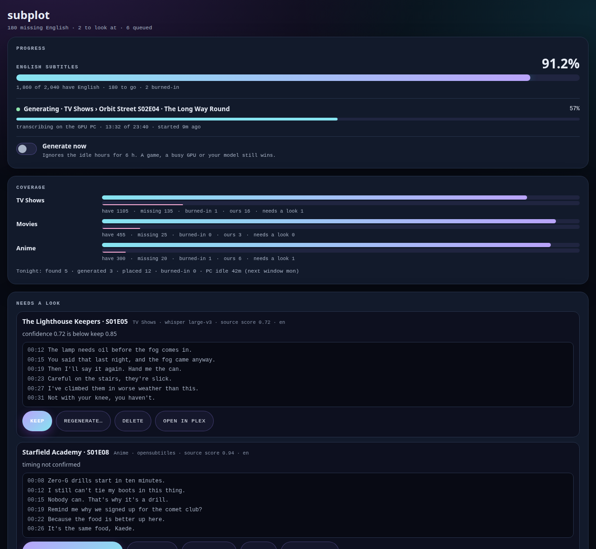
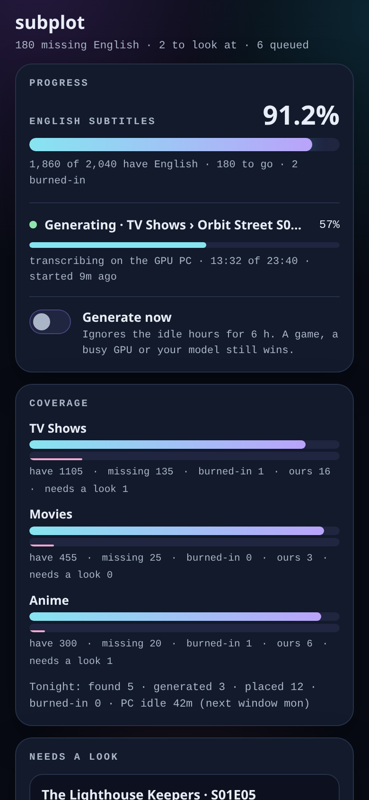
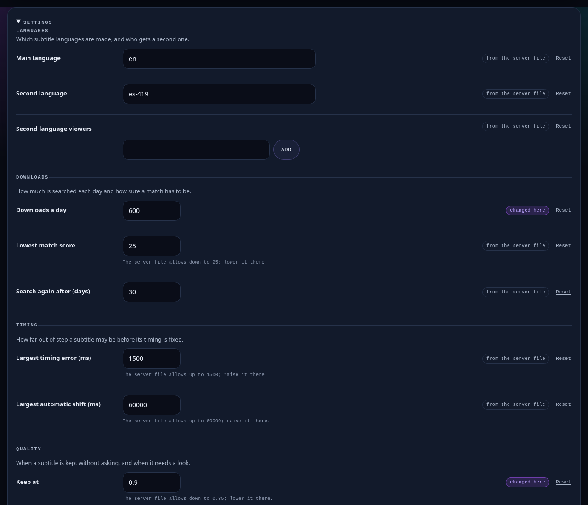

# Subplot

English subtitles for every episode and movie in your Plex library. Subplot finds them on OpenSubtitles, checks their timing
against the audio, generates the rest with Whisper on your gaming PC while you're not using it, and puts each one beside its
video so Plex picks it up.



## Why

Most subtitle tools only see what Sonarr and Radarr manage, and a downloaded subtitle that's 20 seconds off is worse than
none. Subplot works from Plex's own library, refuses any file it can't prove is in sync, and lets you decide on the doubtful
ones from your phone.

## How it works

1. **Scan** reads a copy of Plex's database and lists every item without an English subtitle.
2. **Find** asks OpenSubtitles for each gap, within your daily download quota.
3. **Sync** measures each subtitle against the speech in the audio. In sync: kept. Off by up to a minute: shifted and
   measured again. Anything else: dropped, and the item goes to Whisper.
4. **Generate** sends audio to a Windows PC with an NVIDIA GPU when your rules say it's idle (not during your gaming hours,
   never while a game or another GPU job runs), and brings back a Whisper transcript.
5. **Place** writes the file beside the video, marks it as Subplot's on its last line, and asks Plex to rescan that folder.
   It only ever replaces or deletes files it wrote itself.

A page shows progress, what's missing, and the files that need a look, with buttons to keep, regenerate, fix timing or
delete. It works on a phone too.



## Requirements

- Linux with systemd 255+ (and systemd-resolved for DNS), Python 3.12 and ffmpeg, on the machine that has your media
  drives mounted.
- Plex Media Server on that machine (tested with 1.43), and a regular copy of its library database (below).
- A reverse proxy that serves HTTPS, and either signs you in (an SSO such as Authelia, or basic auth) or leaves that to
  Subplot's own sign-in (`AUTH=login`, below).
- An OpenSubtitles.com account and API key. VIP gives 1,000 downloads a day; free gives 20.
- For generating: a Windows PC with an NVIDIA GPU (8 GB of VRAM or more) reachable over SSH. See [pc/install-pc.md](pc/install-pc.md).

## Install

1. Clone this repository to the server, for example to `/opt/subplot`.
2. Create the account the services run as (not root) and a venv for the timing check:
   `python3 -m venv --copies /opt/subplot/venv && /opt/subplot/venv/bin/pip install -r requirements-sync.txt`
3. Copy the examples into your config folder (default `/etc/subplot`) and edit them:
   - `subplot.conf.example` to `subplot.conf`: the account, folders, media drives, Plex database copy and GPU PC.
   - `rules.example.json` to `rules.json`: where Plex's paths are on this machine.
   - `env.example` to `.env`: your OpenSubtitles login and key and your Plex token. Make it mode 600, owned by the
     service account.

   Everything else (languages, daily downloads, timing, quality, the PC's free hours, programs, libraries) is on the page
   under **Settings**.
4. Set up the GPU PC: [pc/install-pc.md](pc/install-pc.md).
5. Run `sudo ./install.sh /etc/subplot/subplot.conf`. It checks everything first and tells you what to fix.
   `./install.sh --check` renders the services without installing anything.
6. Point your reverse proxy at the socket (below) and open the page.

### The Plex database copy

Subplot never opens Plex's live database. Copy it nightly, for example from root's crontab:

```
30 4 * * * sqlite3 "/var/lib/plexmediaserver/Library/Application Support/Plex Media Server/Plug-in Support/Databases/com.plexapp.plugins.library.db" ".backup /var/backups/plex/library.db" && chgrp media /var/backups/plex/library.db && chmod 640 /var/backups/plex/library.db
```

Plex's own scheduled backups (`com.plexapp.plugins.library.db-YYYY-MM-DD`) work as well.

### Reverse proxy

The page listens only on a unix socket that your proxy's group can open. **The proxy's sign-in is the page's only
protection**, so it must cover every path. With nginx:

```nginx
location / {
    # your sign-in here: auth_request to your SSO, or auth_basic
    proxy_pass http://unix:/var/lib/subplot-sock/board.sock:;
    proxy_http_version 1.1;
    proxy_set_header Host $host;
    proxy_set_header Connection "";
    proxy_set_header Authorization "";
    proxy_set_header Cookie "";
    proxy_read_timeout 15s;
}
```

### Subplot's own sign-in

If your proxy has no sign-in of its own, set `AUTH=login` in `subplot.conf` and run `install.sh` again. Drop the sign-in
line and the `Cookie` line (the page's own session is a cookie) from the block above, and add:

```nginx
    proxy_set_header X-Forwarded-Proto $scheme;
    proxy_set_header X-Real-IP $remote_addr;
```

(Caddy: `header_up X-Forwarded-Proto {scheme}` and `header_up X-Real-IP {remote_host}`.) The proxy must set both, never
pass on what the browser sent. Then get a one-time setup code and create the account on the page:

```
sudo runuser -u <service account> -- env SUBS_STATE=<state folder> python3 -I <code folder>/subplot/auth.py setup-code
```

The same command takes `status`, `unlock` (after 100 wrong tries in a row), `signout` (every browser) and `reset`
(deletes the account only). Signing in works over HTTPS only. In the page's Account section you can turn on an
authenticator app, see and sign out browsers, and change the password.

Under a path prefix, use `location /subs/` and `proxy_pass http://unix:/var/lib/subplot-sock/board.sock:/;` and open the page with the
trailing slash. `PUBLIC_HOST` in `subplot.conf` must match the host name the proxy passes on.

### Settings



Each setting shows whether it comes from the server or was changed on the page, with a Reset back to the server's value.
Changes take effect at the next run of each step. The quality and timing limits can only be made stricter on the page;
to loosen them, put the lower value in `rules.json` on the server (for example `"thresholds": {"keep": 0.8}`). To let
Subplot unload an idle Ollama model on the GPU PC before generating, add to `rules.json`:

```json
"pc_idle": {"unload_idle_model": {"ollama": "http://10.0.0.50:11434", "after_min": 10}}
```

Logins, keys and folders are never shown or changed on the page.

## Updating

`git pull`, then `sudo ./install.sh /etc/subplot/subplot.conf` again. Your config, state and placed subtitles are untouched.

## Security

Subplot opens files from strangers (subtitles) and writes beside your videos, so each step runs as its own sandboxed
systemd service with only the access it needs: only one service can write to the media drives, only two can read the
secrets, the downloader can't reach your network, and the GPU PC never receives a password or token. Details in
[SECURITY.md](SECURITY.md) and [ARCHITECTURE.md](ARCHITECTURE.md); how it was tested in [TESTING.md](TESTING.md).

An adult library named `Hentai` is excluded in the code and can't be turned back on from the rules file.

## What leaves your server

- To OpenSubtitles: the item's IMDb or TMDB id, your login and API key, and download requests.
- To your GPU PC: audio of one episode at a time and 12 small frames, over SSH.
- To Plex on the same machine: a rescan request for a folder after a file is placed.

Nothing else. No telemetry.

## License

MIT. The bundled speech detector `silero_vad.onnx` is Silero VAD's, also MIT: see
[subplot/models/NOTICE-silero.txt](subplot/models/NOTICE-silero.txt).
